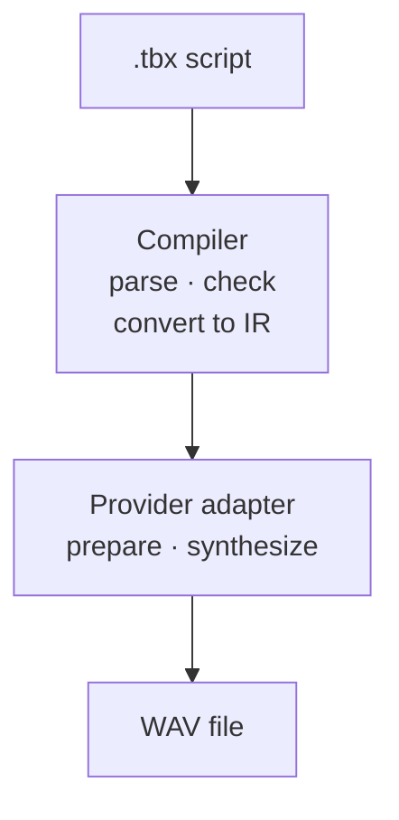
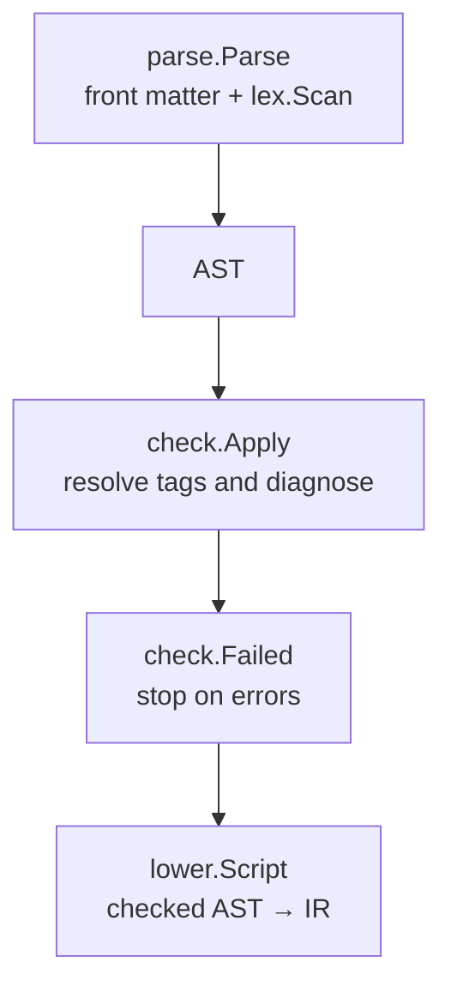
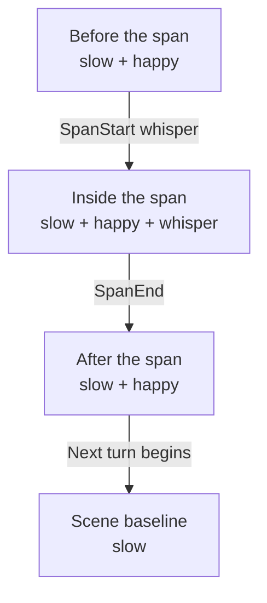
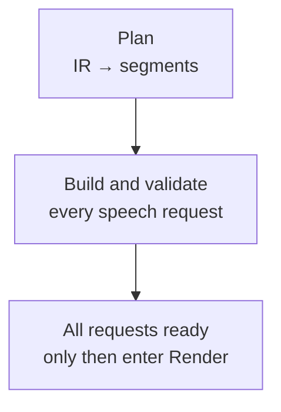
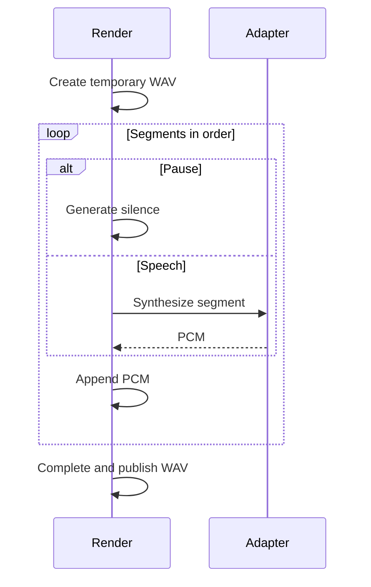

# Architecture and implementation

[简体中文](architecture.zh-cn.md) · [Contributor guide](../contributing.md) · [DSL Specification v1](spec.md)

This guide is for developers who know Go and want to follow Timbrex from a script to a WAV file, find the code responsible for a behavior, or extend an adapter without changing the language. It describes the current implementation. Use the [specification](spec.md) for language rules, [configuration](configuration.md) for settings, and [provider setup](providers.md) and [capabilities](capabilities.md) for vendor-specific contracts.

Timbrex is a small compiler plus an audio renderer. The compiler converts the author's words, speakers, and directions into a provider-independent intermediate representation (IR) for request planning. A real provider adapter resolves that structure into speech requests, calls one vendor sequentially, and joins the returned PCM with local silence. Timbrex does not generate speech itself, and the same script does not promise the same performance across vendors.

## The main path



The CLI calls `parse.Parse`, which extracts front matter and invokes the lexer internally; callers do not manually connect a lexer to a parser. `check.Apply` both reports diagnostics and resolves tag nodes in place. Only a successfully checked AST should reach `lower.Script`.

`check` stops at the checked AST. `synth` continues by converting it to IR and selecting a provider. All seven real adapters currently use `Prepare` and `Render`; these helpers are not methods required by the `Provider` interface. The `stub` implementation is deliberately different: it produces an **8 kHz mono 16-bit test tone**, not speech, and does not reproduce the script's pauses or directions.

## Where the code lives

The root [main.go](../main.go) calls the CLI and formats a failed command's error. There is no `cmd/timbrex` entry point.

| Area | Responsibility | Starting point |
| --- | --- | --- |
| `internal/cli` | Cobra commands, configuration loading, pipeline wiring, output-path checks | [cli.go](../internal/cli/cli.go), [synth.go](../internal/cli/synth.go) |
| `internal/inputfile` | Read regular script and configuration files without blocking on FIFOs | [read.go](../internal/inputfile/read.go) |
| `internal/config` | Typed settings, defaults, YAML and environment merge, provider resolution | [config.go](../internal/config/config.go), [defaults.go](../internal/config/defaults.go) |
| `internal/lex`, `internal/parse`, `internal/ast` | Tokens, block and inline syntax, front matter, source positions | [lex.go](../internal/lex/lex.go), [parse.go](../internal/parse/parse.go), [ast.go](../internal/ast/ast.go) |
| `internal/check`, `internal/vocab` | Tag resolution, language diagnostics, standard tag kinds | [check.go](../internal/check/check.go), [vocab.go](../internal/vocab/vocab.go) |
| `internal/lower`, `internal/ir` | Flatten checked syntax into provider-independent utterances | [lower.go](../internal/lower/lower.go), [ir.go](../internal/ir/ir.go) |
| `internal/providers` | Registry, scope planning, request preparation, HTTP and audio helpers | [provider.go](../internal/providers/provider.go), [plan.go](../internal/providers/plan.go) |
| `internal/providers/<name>` | One vendor's request mapping and response decoding | [OpenAI example](../internal/providers/openai/openai.go) |
| `editors/vscode` | TextMate grammar and editor runtime tests, not the compiler parser | [Editor guide](../editors/vscode/readme.md) |

The dependency boundaries are intentional. AST and IR are data structures, not services. Parsing does not know about credentials or providers. Conversion to IR uses vocabulary kinds but does not interpret vendor mappings. Adapters receive IR and resolved options rather than importing Cobra or reloading environment variables. Only `internal/cli` imports Cobra. [AGENTS.md](../AGENTS.md) records the package rules.

## Follow one script

[examples/architecture.tbx](../examples/architecture.tbx) is the running example:

```tbx
---
strict_tags: true
provider: openai
cast:
  lin: {voices: {openai: coral}}
---
[slow]
lin: [happy] Hello. [pause 200ms] [whisper|Come closer.] Back again.
lin: [fast] Hurry. [reset speed] Take your time.
```

From the repository root:

```bash
make build
./timbrex check examples/architecture.tbx
./timbrex synth examples/architecture.tbx --provider stub -o architecture.wav
```

The first command using `timbrex` prints `ok`; the second prints `architecture.wav` and writes a test tone without contacting a TTS service. The explicit `--provider stub` wins over the script's `provider: openai`. It tests file output, not the OpenAI mapping described below. These commands assume a valid local configuration; `check` also loads configuration.

The example has one scene-state line and two turns by `lin`. In the first turn, `happy` lasts to the turn boundary, while `whisper` applies only inside its span. The next turn begins with the scene's `slow` state, replaces it with `fast`, then restores the scene's speed with `reset speed`.

## Configuration and input boundaries

[cli.go](../internal/cli/cli.go) loads configuration once in Cobra's `PersistentPreRunE` for `check`, `synth`, and `config`. Help and version do not load it. [inputfile.Read](../internal/inputfile/read.go) follows symlinks, opens nonblocking, checks the opened file's type, and rejects nonregular inputs before reading. The nonblocking open prevents a FIFO from hanging before its type can be inspected. Regular inputs are then read in full; there is no configured script-size ceiling.

For settings that have these sources, precedence is:

```text
CLI flags > script front matter > environment > selected YAML file > defaults
```

This is implemented in two stages rather than by feeding everything to one merge:

- `config.Load` combines defaults, one YAML file, and documented environment variables. Without `--config`, the file is `./timbrex.yaml` in the working directory, not beside the script. An explicitly selected missing file is an error. Invalid file fields are checked before environment overrides can hide them.
- After parsing, the CLI chooses strict mode and, for synthesis, the provider, model, and default voice. `Config.Resolve` then requires the selected real provider's credentials and required endpoint/model settings. Adapters receive a `providers.Options` value containing `Out`, `Model`, `Voice`, `APIKey`, and `Endpoint`.

The precedence statement is not a promise that every setting has a CLI or front-matter form. Credentials and endpoints belong in configuration/environment, not scripts. `config` prints redacted merged settings; it does not apply a script's front matter. See the [configuration reference](configuration.md) for the exact fields and environment bindings.

Voice selection has an additional, separate layer. For each speech segment, the planner starts with `cast[speaker].voices[selectedProvider]`, falling back to the resolved default voice. Thus `--voice` changes the fallback, not an explicit cast mapping. Active `[voice …]` or `[as …]` controls can override that choice. `[as lin]` selects Lin's mapping for the current provider; it does not switch providers or change the utterance's speaker ID. A known speaker without a mapping uses the fallback; an unknown speaker reference fails during planning. Front-matter `lang` is the segment's initial language hint, which `[lang …]` can override.

## From source text to checked AST

### Lexing and parsing

The compiler path stays independent of vendor requests. The `check` command stops after checking; only synthesis continues to convert the AST to IR.



[parse.Parse](../internal/parse/parse.go) rejects invalid UTF-8, normalizes a leading BOM and line endings, parses YAML front matter, then calls [lex.Scan](../internal/lex/lex.go) on the remaining body. Tokens carry source positions and nesting information. Front-matter line offsets are added back so diagnostics refer to the original file.

The parser builds `ast.Script{Front, Blocks}`. Blocks distinguish narration, speaker turns, comments, scene lines, and raw fences. Inline nodes distinguish text from tags; a span owns a nested `Content` slice. Arguments retain `Key`, `Raw`, and a lexical `Kind`, such as `duration` or `quoted`. They are not yet vendor parameters: `200ms` is stored as text with a duration kind, not immediately converted to `time.Duration`.

A prefix such as `lin:` becomes a turn only if `lin` is declared in `cast`, or the script uses `cast: auto`. Otherwise the text remains narration. A line containing only point tags and whitespace is a scene line. A span containing words is not a scene-state declaration. These distinctions explain why moving a tag onto its own line can change its scope.

For the example, the important AST structure is shown below. This is explanatory notation, not a serialized API; text spacing and source positions are omitted.

```text
Script
  Front: Provider=openai, StrictTags=true
         Cast[lin].Voices[openai]=coral
  Scene
    Tag(slow)
  Turn(lin)
    Tag(happy)
    Text("Hello.")
    Tag(pause, Arg{Raw:"200ms", Kind:"duration"})
    Tag(whisper, Span:true)
      Text("Come closer.")
    Text("Back again.")
  Turn(lin)
    Tag(fast)
    Text("Hurry.")
    Tag(reset, Arg{Raw:"speed", Kind:"word"})
    Text("Take your time.")
```

### Checking resolves meaning within the language

[check.Apply](../internal/check/check.go) walks the AST and returns diagnostics. It also updates tag names and acting metadata; it is not a read-only validator. Standard tags and aliases come from [vocab](../internal/vocab/vocab.go). In non-strict mode, an unregistered free-form tag can become `act`; in strict mode, unknown tags produce `V041` and acting directions must use explicit `act` syntax.

`check.Failed` turns error-severity diagnostics into a command failure. Warnings and informational diagnostics do not prevent the subsequent conversion. The CLI writes diagnostics to stderr and writes `ok` to stdout only after a successful check. Parser errors carry file, line, and column; checker diagnostics may also carry codes. The complete diagnostic rules belong in the [specification](spec.md).

The checker does **not** establish that an adapter supports every tag, that a numerical argument is in a vendor's range, or that credentials and voice IDs work. For example, a recognized `[pitch …]` tag may be valid language but unsupported by a selected adapter. Raw fences can also parse and check successfully even though the current real-provider planner rejects them. `check` still validates centralized configuration because configuration loading precedes the command, but it does not call `Config.Resolve`, convert the AST to IR, or run provider preparation.

## Convert to intermediate representation

[lower.Script](../internal/lower/lower.go) converts the checked AST to an `ir.Document`. It copies front-matter provider/model/default voice/language and cast voice mappings, removes comments, and emits an utterance for each remaining block. Narration uses `narrator` unless front matter names another narration speaker. An empty `Utterance.Speaker` marks a scene line or raw fence, never ordinary spoken narration.

Inline AST nesting becomes a flat node sequence:

- Literal text becomes `ir.Text`.
- Point tags become `ir.State` or `ir.Event`, according to vocabulary kind and resolved acting metadata.
- Spans become paired `ir.SpanStart` and `ir.SpanEnd` markers around their content.
- A raw fence becomes `ir.Raw`; the conversion preserves it rather than interpreting vendor markup.

Arguments keep their typed lexical representation. The IR has no separate scope field and does not contain HTTP requests or computed durations. Utterance boundaries, node kinds, and paired span markers carry the structure that the planner needs.

The example produces this simplified IR sequence:

```text
Utterance("")
  State(slow)
Utterance("lin")
  State(happy), Text("Hello."), Event(pause, duration:200ms)
  SpanStart(whisper), Text("Come closer."), SpanEnd(whisper)
  Text("Back again.")
Utterance("lin")
  State(fast), Text("Hurry."), State(reset, word:speed)
  Text("Take your time.")
```

This representation keeps the compiler small: structure is converted once, while a provider can inspect the complete document without reparsing source text. This step cannot be used as a substitute for checking. Source-based tests follow `parse.Parse` → `check.Apply` → `check.Failed` → `lower.Script`.

## Planning resolves scope and splits speech

[providers.Plan](../internal/providers/plan.go) converts an IR document into `[]Segment`. Each segment contains either a local `Pause`, or a voice, language hint, active `Controls`, and speakable `Nodes`.

The planner maintains scene state, a working state for the current utterance, and a stack of saved states for nested spans. The example shows the state before, inside, and after `whisper`, then at the start of the next turn:



A state change flushes pending speech before taking effect. A span pushes the current state, applies its control, and restores the saved state at the closing marker. Each new spoken turn starts from scene state, not from the preceding speaker's last state.

Controls replace others in the same feature group: `slow`, `fast`, and `speed` share speed; `voice` and `as` share voice; `whisper` and `shout` share delivery; named emotions share emotion. Other names use their own feature key. `[reset]` restores the turn's scene baseline; `[reset speed]` restores only that feature. In a scene line the baseline is empty, so reset clears scene state or the selected scene feature. A reset inside a span uses that same utterance baseline, not the saved outer span state; closing the span still restores the saved state.

For the running example, planning yields six segments. Text is trimmed here for readability; the implementation preserves its text nodes.

| Segment | Content | Voice | Active controls |
| --- | --- | --- | --- |
| 1 | `Hello.` | `coral` | `slow`, `happy` |
| 2 | 200 ms local silence | Not used | Not used |
| 3 | `Come closer.` | `coral` | `slow`, `happy`, `whisper` |
| 4 | `Back again.` | `coral` | `slow`, `happy` |
| 5 | `Hurry.` | `coral` | `fast` |
| 6 | `Take your time.` | `coral` | `slow` |

Whitespace-only pending text does not produce a speech segment. Pause aliases are converted locally, with each duration limited to 0 ms through 1 minute; a zero pause does not add a silence segment. Other events remain in speech nodes for the adapter to accept or reject. Planning also rejects unmatched closing markers and unclosed spans in manually built IR, raw fences, missing effective voices, unknown `as` targets, and scripts with no speech or positive pauses.

This is segmentation by control boundaries, not a sentence tokenizer or a general chunker. Adjacent segments are not automatically merged, and long text is not automatically split to satisfy vendor limits. More boundaries can mean more requests and less natural joins.

## Preparing requests before network I/O

[Prepare](../internal/providers/prepare.go) is a generic helper: it runs `Plan`, allocates a request slice aligned with segment indices, and calls the adapter's builder for every speech segment. Local pauses keep a zero-value request that is never sent. If any builder rejects a segment, no synthesis request has started.



This ordering catches unsupported controls late in a script before earlier segments incur remote synthesis work. It does not prove that a remote service will accept the model, voice, account, or request. CLI credential resolution also happens before preparation, so `synth` is not an offline provider-check command.

In the [OpenAI adapter](../internal/providers/openai/openai.go), `build` combines speech nodes into text, maps speed to a numeric parameter, and turns supported acting controls into `instructions`. Using the default OpenAI model settings, the first segment has these meaningful fields:

```json
{
  "model": "gpt-4o-mini-tts",
  "input": " Hello. ",
  "voice": "coral",
  "response_format": "pcm",
  "instructions": "happy",
  "speed": 0.8
}
```

The `whisper` segment has `happy. whisper` instructions. The pause has no HTTP request. This describes the current adapter's serialization, not a live service acceptance or acoustic-quality claim. Model lifecycle, valid voices, supported ranges, and vendor differences are maintained in the [provider reference](providers.md) and [capability reference](capabilities.md).

Validation follows what is actually used. A control overridden before any speech may never reach an adapter builder; a trailing unsupported state with no speech after it is not the same as an unsupported control on a speech segment. Common structural checks such as invalid pause durations and raw fences happen in planning. There is no universal per-tag parameter-schema checker in the compiler.

## The provider extension contract

The interface in [provider.go](../internal/providers/provider.go) is intentionally small:

```go
type Provider interface {
    ID() string
    Synthesize(ctx context.Context, doc *ir.Document, opt Options) (Result, error)
}
```

An adapter registers an implementation in `init`; the CLI blank-imports shipped adapters. Registry lookup is by ID, duplicate IDs panic during initialization, and the displayed ID list is sorted. Registration runs during startup from compiled-in Go packages, not through dynamic loading of external plugins.

A new adapter normally needs four connected changes:

- Implement its documented request and response contract in `internal/providers/<name>`, using `Prepare` and `Render` when the sequential PCM path fits. Builders must remain network-free and validate supported controls, arguments, text limits, and model restrictions before I/O.
- Register and blank-import it, then add defaults and environment bindings in `internal/config`. Configuration validation uses the known provider set too; registration alone is insufficient for CLI support.
- Normalize successful audio to the shared PCM contract, preserve cancellation, and reject malformed or unsupported responses. Do not silently drop controls or pass through arbitrary vendor markup.
- Add offline adapter and CLI contract tests, and update both language versions of provider setup and capabilities. Read and cite the vendor's official API documentation before implementing fields.

A new vendor normally does not require AST or grammar changes. Shared helpers belong in `internal/providers` only when they serve concrete common behavior. No vendor SDKs, provider fallback chain, request cache, or dynamic capability-file subsystem is currently present.

## From HTTP responses to a complete WAV

After preparation succeeds, real adapters render one segment at a time. This smaller sequence focuses on the renderer and its callback; the adapter handles HTTP and decoding, and the renderer writes to the temporary file:



The diagram shows the success path. Speech PCM is validated before writing; final publication fills the header, closes the file, checks cancellation, and renames it. Any error returns without processing later segments or publishing the temporary file.

### Transport and decoding

[http.go](../internal/providers/http.go) provides JSON posting and lower-level requests. The default HTTP client has a two-minute timeout and refuses redirects. Requests carry the command context. Non-2xx responses and HTTP 206 are errors; response bodies and signed URLs are not copied into the corresponding status/transport diagnostics.

Each response is bounded to **64 MiB**. A declared `Content-Length` over the limit is rejected before reading the body. Missing, misleading, or chunked lengths are still bounded with a `LimitReader` of limit plus one byte, followed by an actual-size check. Empty responses fail. PCM responses also have a Content-Type check, including rate and channel parameters when supplied; a missing header is not proof of a format.

Adapters handle their own envelopes: some request raw PCM directly, others decode JSON/base64/hex or fetch a returned audio URL. [DecodeWAV](../internal/providers/wav.go) handles supported WAV responses by validating their structure and extracting PCM. This is not a general-purpose transcoder. Audio must reach the renderer as **24 kHz, mono, signed 16-bit little-endian PCM (S16LE)**. The renderer rejects empty or odd-length speech audio and recognizable encoded-audio containers. Raw PCM has no self-describing sample rate, so byte checks alone cannot prove that a service honored the requested format.

### Writing and publishing

[Render](../internal/providers/audio.go) reserves a 44-byte WAV header, processes one segment at a time, writes PCM to disk, and fills in the header after all segments succeed. A pause produces zero-valued samples locally. The accumulated PCM payload is capped at **1 GiB**. There is no resampling, crossfade, mixing, overlap, or audio repair.

[WriteOutput](../internal/providers/output.go) creates a `.timbrex-*.partial` file in the destination directory. It closes the complete file, checks cancellation, and publishes it with `os.Rename`; cleanup removes the temporary file on ordinary failure. An existing output is left untouched when synthesis, decoding, or writing fails before publication. New and replaced files use `CreateTemp`'s private `0600` mode before umask, rather than preserving the old destination's permissions.

This is complete-file publication, not a filesystem transaction or crash-durability guarantee. There is no `fsync` or directory sync; rename semantics depend on the OS and filesystem. Completed remote requests cannot be undone if a later segment fails. The CLI rejects non-WAV output extensions, directories, and a destination that is the same file as the source script. It does not create missing parent directories.

## Errors and cancellation

[cli.Run](../internal/cli/cli.go) derives a context from interrupt and SIGTERM. The CLI checks it before and after script loading stages, after conversion to IR, and before provider invocation; the renderer checks between segments and before final publication, while HTTP requests observe it during I/O. The internal loops for parsing, checking, IR conversion, and planning do not take a context, so cancellation is not checked at every CPU operation. Once output publication succeeds, a later cancellation does not turn that committed success into failure.

Errors identify the layer that failed: parse locations and checker codes for language problems, provider-prefixed builder failures, and provider plus one-based segment index for synthesis callback failures. Planning errors pass through `Prepare` without that added prefix. Segment numbers include local pauses. The main process prints the failure to stderr and exits with status 1 rather than printing a successful output path.

Cancellation and failure tests verify preservation of an existing destination and cleanup of temporary output. These guarantees do not make a multi-request synthesis transactional: earlier requests may already have been processed or billed, and there is no automatic retry, resume, or rollback.

## Memory use and performance tradeoffs

The implementation avoids retaining all completed audio in memory: each completed segment is written to the temporary file before the next request. However, it is **not streaming synthesis or streaming playback**. Each HTTP response is read fully within its bound, an adapter may allocate decoded copies, and the final WAV is not published until the entire render succeeds.

The source, AST, IR, planned segments, and all prepared request objects can also coexist. There is no global memory budget or automatic long-script partitioning. The 64 MiB response limit and 1 GiB output limit protect different resources; neither is a bound on total process memory.

A few implementation details avoid repeated work without introducing a compiler framework:

- The lexer advances through source text rather than repeatedly recounting the remaining suffix; `lower.Script` appends nested span content into one growing IR slice.
- The planner indexes declared and observed speakers once, allowing forward `as` references without scanning all utterances for every reference.
- A checker pass reuses spelling suggestions for repeated unknown tags. Display-name warning candidates are indexed for that pass rather than scanning the whole cast for every narration block. These are local analysis optimizations, not persistent caches or cached audio.
- The HTTP helper rejects an oversized declared response before allocating a body buffer, while retaining the bounded-read fallback for untrusted lengths.

Sequential execution makes ordering, failure handling, and output assembly easy to follow. Its cost is that request latencies add up and control-heavy scripts produce many calls. Parallel scheduling, automatic request coalescing, streaming, and acoustic continuity guarantees are not implemented. See the [design notes](reflection.md) for broader language and rendering tradeoffs.

## Tests and a useful reading order

Tests live beside the packages they exercise. Together they cover different contracts, rather than one end-to-end claim about speech quality:

| Test layer | What it establishes | Examples |
| --- | --- | --- |
| Lexer/parser/checker | Syntax, positions, front matter, tag resolution, diagnostics | [parse tests](../internal/parse/parse_test.go), [checker tests](../internal/check/check_test.go), [fuzz tests](../internal/parse/fuzz_test.go) |
| IR conversion/planning | Typed arguments, flattening, scene/turn/span restoration, voices and pauses | [conversion tests](../internal/lower/lower_test.go), [plan tests](../internal/providers/plan_test.go), [voice tests](../internal/providers/as_voice_test.go) |
| Preparation/adapters | Reject invalid later segments before network I/O; serialize documented requests | [prepare tests](../internal/providers/prepare_test.go), [OpenAI tests](../internal/providers/openai/openai_test.go) |
| HTTP/audio/output | Size bounds, malformed audio, WAV validation, cancellation, destination preservation | [HTTP tests](../internal/providers/http_test.go), [WAV tests](../internal/providers/wav_test.go), [output tests](../internal/providers/output_test.go) |
| CLI integration | Configuration through request mapping and file output using local HTTP servers | [provider CLI tests](../internal/cli/providers_test.go), [cancellation tests](../internal/cli/cancel_test.go) |
| Documentation/editor | Parse/check examples, local links, bilingual structure, fences, actual grammar tokenization | [docs_test.go](../docs_test.go), [editor tests](../editors/vscode/readme.md) |

After installing the Go version from [go.mod](../go.mod), the pinned linter, and Node.js 24, install dependencies once and run:

```bash
go mod download
make editor-deps
make verify
```

`make verify` runs module-tidiness checking, build and Go tests, lint and formatter checks, and editor runtime tests. With tools and dependencies already installed, verification is offline and uses no TTS credentials. For focused work:

```bash
go test ./internal/parse ./internal/check ./internal/lower
go test ./internal/providers/... ./internal/cli
go test -run 'TestDocumentationExamplesAndLinks|TestBilingualDocPairs|TestMarkdownFencesAndTables' .
```

The Markdown test accepts Mermaid fences but does not parse or render their diagrams; diagram edits need a separate Mermaid renderer check. Mock HTTP tests validate Timbrex's behavior, not a vendor account's current acceptance, model availability, or resulting audio quality. Live validation is a separate opt-in activity described in the [contributor guide](../contributing.md).

For a first code-reading pass, follow the running example in this order:

1. [cli/load.go](../internal/cli/load.go) and [cli/synth.go](../internal/cli/synth.go): see where `check` ends and synthesis continues.
2. [ast.go](../internal/ast/ast.go), [parse.go](../internal/parse/parse.go), and [check.go](../internal/check/check.go): understand the tree and why checking mutates it.
3. [lower.go](../internal/lower/lower.go) and [ir.go](../internal/ir/ir.go): follow one span into paired flat markers.
4. [plan.go](../internal/providers/plan.go) and its tests: trace the example's six segments and reset behavior.
5. [prepare.go](../internal/providers/prepare.go) and [openai.go](../internal/providers/openai/openai.go): separate local request construction from network execution.
6. [http.go](../internal/providers/http.go), [audio.go](../internal/providers/audio.go), and [output.go](../internal/providers/output.go): follow one response into the published WAV.

This path covers the complete implementation before requiring a reader to learn every vendor's API.
