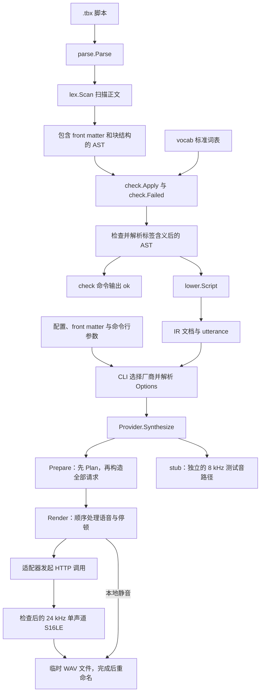
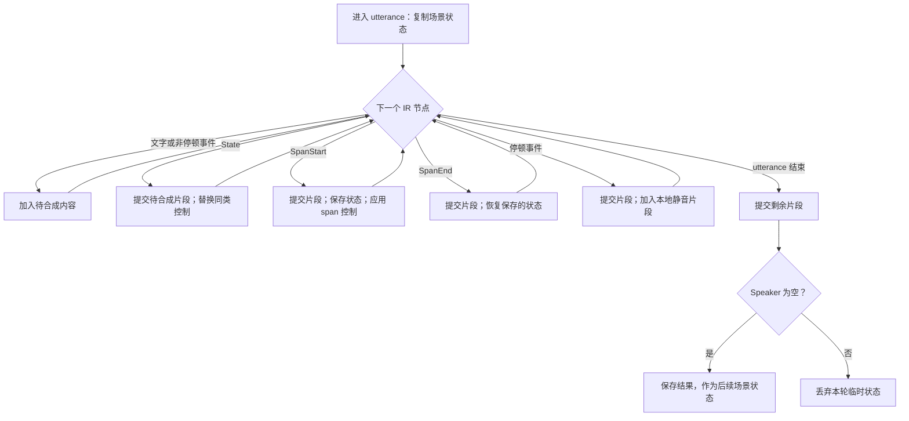
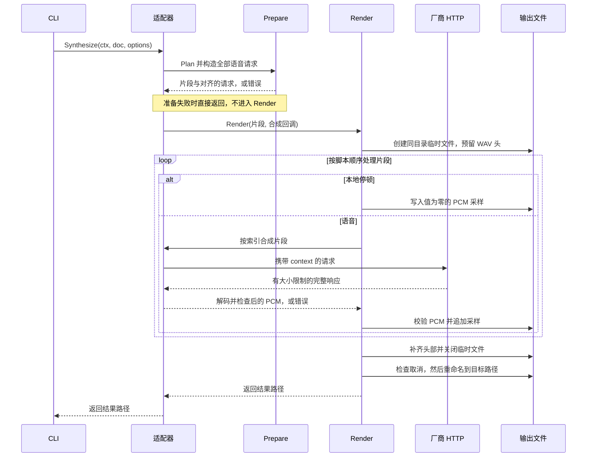

# 整体架构与实现

[English](architecture.md) · [贡献指南](../contributing.zh-cn.md) · [DSL 规范 v1](spec.zh-cn.md)

本文面向熟悉 Go、初次接触 Timbrex 的开发者。读完后，你应能跟着一份脚本走到 WAV 输出，找到某个行为对应的代码，并在不修改语言的前提下扩展适配器。本文介绍当前实现；语言规则以 [DSL 规范](spec.zh-cn.md)为准，设置项见[配置参考](configuration.zh-cn.md)，厂商相关约定见[厂商接入指南](providers.zh-cn.md)和[能力参考](capabilities.zh-cn.md)。

Timbrex 由一个小型编译器和音频渲染器组成。编译器把台词、角色和表演指令保存在与厂商无关的中间表示（IR）中。真实厂商适配器再把这些结构转换成语音请求，按顺序调用同一家服务，并将返回的 PCM 与本地静音拼接起来。Timbrex 自身不生成语音，同一份脚本也不保证在不同厂商下得到相同的表演效果。

## 主流程



CLI 调用的是 `parse.Parse`。该函数先提取 front matter，再在内部调用词法分析器，调用方不需要手动连接 lexer 和 parser。`check.Apply` 既生成诊断，也原地更新标签节点。只有通过检查的 AST 才应交给 `lower.Script`。

`check` 到完成检查的 AST 为止；`synth` 继续执行 lowering 和厂商选择。当前七个真实厂商适配器都使用 `Prepare` 与 `Render`，但这两个函数只是共享辅助函数，并不是 `Provider` 接口要求实现的方法。`stub` 刻意采用另一条路径：生成 **8 kHz、单声道、16 位测试音**，不读出台词，也不重现脚本里的停顿和表演指令。

## 代码分布

仓库根目录的 [main.go](../main.go) 调用 CLI，并格式化失败命令的错误。项目没有 `cmd/timbrex` 入口。

| 位置 | 职责 | 建议入口 |
| --- | --- | --- |
| `internal/cli` | Cobra 命令、配置加载、流程编排、输出路径检查 | [cli.go](../internal/cli/cli.go)、[synth.go](../internal/cli/synth.go) |
| `internal/inputfile` | 读取普通脚本和配置文件，避免在 FIFO 上阻塞 | [read.go](../internal/inputfile/read.go) |
| `internal/config` | 类型化配置、默认值、YAML 与环境变量合并、厂商设置解析 | [config.go](../internal/config/config.go)、[defaults.go](../internal/config/defaults.go) |
| `internal/lex`、`internal/parse`、`internal/ast` | token、块与行内语法、front matter、源码位置 | [lex.go](../internal/lex/lex.go)、[parse.go](../internal/parse/parse.go)、[ast.go](../internal/ast/ast.go) |
| `internal/check`、`internal/vocab` | 标签含义解析、语言诊断、标准标签分类 | [check.go](../internal/check/check.go)、[vocab.go](../internal/vocab/vocab.go) |
| `internal/lower`、`internal/ir` | 将已检查的语法树展平为与厂商无关的 utterance | [lower.go](../internal/lower/lower.go)、[ir.go](../internal/ir/ir.go) |
| `internal/providers` | 注册表、作用域规划、请求准备、HTTP 与音频辅助函数 | [provider.go](../internal/providers/provider.go)、[plan.go](../internal/providers/plan.go) |
| `internal/providers/<name>` | 某一家厂商的请求映射和响应解码 | [OpenAI 示例](../internal/providers/openai/openai.go) |
| `editors/vscode` | TextMate 语法及编辑器运行时测试，不是编译器的解析器 | [编辑器指南](../editors/vscode/readme.zh-cn.md) |

这些依赖边界有明确用途。AST 和 IR 只是数据结构，不承担服务调用。解析器不需要知道凭证或厂商；lowering 只知道词表分类，不知道厂商映射。适配器接收 IR 和已解析的选项，不导入 Cobra，也不重新读取环境变量。只有 `internal/cli` 可以导入 Cobra。完整的包边界规则见 [AGENTS.md](../AGENTS.md)。

## 用一份脚本贯穿流程

下文使用 [examples/architecture.tbx](../examples/architecture.tbx)：

```tbx
---
strict_tags: true
provider: openai
cast:
  lin: {voices: {openai: coral}}
---
[slow]
lin: [happy] Hello. [pause 200ms] [whisper|Come closer.] Back again.
lin: [fast] Hurry. [reset speed] Take your time.
```

在仓库根目录运行：

```bash
make build
./timbrex check examples/architecture.tbx
./timbrex synth examples/architecture.tbx --provider stub -o architecture.wav
```

第一条 `timbrex` 命令输出 `ok`；第二条输出 `architecture.wav`，写入测试音，不访问 TTS 服务。显式指定的 `--provider stub` 优先于脚本中的 `provider: openai`。它验证文件输出流程，并不验证下文介绍的 OpenAI 请求映射。这些命令要求本地配置有效，因为 `check` 也会加载配置。

示例包含一行场景状态，以及 `lin` 的两轮发言。第一轮的 `happy` 持续到发言结束，`whisper` 只影响 span 内的文字。下一轮从场景的 `slow` 状态开始，先用 `fast` 替换语速，再通过 `reset speed` 恢复场景语速。

## 配置与输入边界

[cli.go](../internal/cli/cli.go) 在 Cobra 的 `PersistentPreRunE` 中，为 `check`、`synth` 和 `config` 加载一次配置；帮助和版本命令不加载配置。[inputfile.Read](../internal/inputfile/read.go) 会跟随符号链接，以非阻塞方式打开文件，检查已打开文件的类型，并在读取前拒绝非普通文件。非阻塞打开是为了避免 FIFO 在检查类型之前就挂住。普通文件随后被完整读入，目前没有可配置的脚本大小上限。

对于具有相应来源的设置，优先级为：

```text
命令行参数 > 脚本 front matter > 环境变量 > 选定的 YAML 文件 > 默认值
```

实现分为两步，并不是把所有来源交给同一次合并：

- `config.Load` 合并默认值、一份 YAML 文件和已登记的环境变量。不指定 `--config` 时，读取工作目录中的 `./timbrex.yaml`，而不是脚本所在目录。显式指定的文件不存在会报错。环境变量覆盖前会先校验文件，避免覆盖值掩盖其中的错误字段。
- 解析脚本后，CLI 决定严格模式；合成时还会选择厂商、模型和默认音色。随后 `Config.Resolve` 检查所选真实厂商的凭证，以及必需的端点和模型设置。适配器收到的 `providers.Options` 包含 `Out`、`Model`、`Voice`、`APIKey` 和 `Endpoint`。

这条优先级规则不表示每个设置都有命令行参数或 front matter 形式。凭证和端点应放在配置或环境变量中，不放在脚本里。`config` 显示脱敏后的合并配置，不读取某份脚本的 front matter。各字段和环境变量的准确对应关系见[配置参考](configuration.zh-cn.md)。

音色还要经过另一层选择。规划每个语音片段时，先查 `cast[speaker].voices[selectedProvider]`，没有映射才使用已解析的默认音色。因此，`--voice` 改变的是回退音色，不会覆盖显式的 cast 映射。生效中的 `[voice …]` 或 `[as …]` 可以进一步覆盖这个选择。`[as lin]` 使用 Lin 在当前厂商下的音色映射，不切换厂商，也不改变 utterance 的角色 ID。已知角色没有映射时使用回退音色，引用未知角色则在规划时报错。front matter 的 `lang` 是片段最初的语言提示，可被 `[lang …]` 覆盖。

## 从源码到已检查的 AST

### 词法分析与解析

[parse.Parse](../internal/parse/parse.go) 拒绝无效 UTF-8，移除开头的 BOM、统一换行符，解析 YAML front matter，再调用 [lex.Scan](../internal/lex/lex.go) 扫描正文。token 携带源码位置和嵌套信息。解析器会补回 front matter 占用的行数，使诊断指向原文件的位置。

解析结果为 `ast.Script{Front, Blocks}`。块区分旁白、角色发言、注释、场景行和原始围栏。行内节点区分文字与标签；span 通过嵌套的 `Content` 切片保存内容。参数保留 `Key`、`Raw` 和 `Kind`，例如 `duration` 或 `quoted`。这些还不是厂商参数：`200ms` 保存为带有 duration 分类的文本，不会立即转换成 `time.Duration`。

只有 `lin` 已在 `cast` 中声明，或者脚本使用了 `cast: auto`，`lin:` 前缀才会形成角色发言，否则仍是旁白文字。只含点标签与空白的行是场景行，包含文字的 span 则不是场景状态声明。这也解释了为什么把标签移到独立一行可能改变作用域。

示例的主要 AST 结构如下。这是便于阅读的示意，不是序列化接口；省略了文字空格和源码位置。

```text
Script
  Front: Provider=openai, StrictTags=true
         Cast[lin].Voices[openai]=coral
  Scene
    Tag(slow)
  Turn(lin)
    Tag(happy)
    Text("Hello.")
    Tag(pause, Arg{Raw:"200ms", Kind:"duration"})
    Tag(whisper, Span:true)
      Text("Come closer.")
    Text("Back again.")
  Turn(lin)
    Tag(fast)
    Text("Hurry.")
    Tag(reset, Arg{Raw:"speed", Kind:"word"})
    Text("Take your time.")
```

### 检查阶段解析语言内的含义

[check.Apply](../internal/check/check.go) 遍历 AST 并返回诊断，同时更新标签名称和表演指令元数据，因此它不是只读校验器。标准标签与别名来自 [vocab](../internal/vocab/vocab.go)。非严格模式下，未登记的自由形式标签可以转换为 `act`；严格模式下，未知标签产生 `V041`，表演指令需要使用显式 `act` 语法。

`check.Failed` 将 error 级别的诊断转换为命令失败，警告和提示不会阻止 lowering。CLI 把诊断写到 stderr，仅在检查成功后向 stdout 写入 `ok`。解析错误带有文件、行号和列号，检查诊断还可能带有诊断码。完整诊断规则见 [DSL 规范](spec.zh-cn.md)。

检查通过**不代表**适配器支持全部标签、数值参数处于厂商允许的范围内，或凭证和音色 ID 可以使用。例如，已登记的 `[pitch …]` 可以是合法语言，却不被选定的适配器支持。原始围栏也可能通过解析和检查，但当前真实厂商的规划器会拒绝它。由于命令执行前加载配置，`check` 仍会验证集中配置；不过它不会调用 `Config.Resolve`，不会转换 IR，也不会执行厂商请求准备。

## Lowering 保留结构，不解释厂商含义

[lower.Script](../internal/lower/lower.go) 将已检查的 AST 转换为 `ir.Document`。它复制 front matter 中的厂商、模型、默认音色、语言及 cast 音色映射，删除注释，并为其余每个块生成一个 utterance。旁白默认使用 `narrator`，也可以通过 front matter 指定其他旁白角色。空的 `Utterance.Speaker` 表示场景行或原始围栏，不表示普通旁白。

嵌套的 AST 节点被展平为一串 IR 节点：

- 普通文字转换为 `ir.Text`。
- 点标签依据词表分类和已解析的表演元数据，转换为 `ir.State` 或 `ir.Event`。
- span 转换为包围其内容的 `ir.SpanStart` 和 `ir.SpanEnd`。
- 原始围栏转换为 `ir.Raw`。lowering 保留其内容，不解释厂商标记。

参数仍保留词法分类和原始值。IR 没有单独的 scope 字段，也不包含 HTTP 请求或计算后的时长。utterance 边界、节点类型和成对的 span 标记共同表达后续规划所需的结构。

示例得到的简化 IR 为：

```text
Utterance("")
  State(slow)
Utterance("lin")
  State(happy), Text("Hello."), Event(pause, duration:200ms)
  SpanStart(whisper), Text("Come closer."), SpanEnd(whisper)
  Text("Back again.")
Utterance("lin")
  State(fast), Text("Hurry."), State(reset, word:speed)
  Text("Take your time.")
```

这样可以保持编译器简单：lowerer 只转换一次结构，适配器拿到完整文档后无需重新解析源码。但 lowering 不能代替检查。从源码出发的测试必须依次执行 `parse.Parse` → `check.Apply` → `check.Failed` → `lower.Script`。

## 规划作用域并拆分语音片段

[providers.Plan](../internal/providers/plan.go) 将 IR 文档转换为 `[]Segment`。每个片段要么是本地 `Pause`，要么包含音色、语言提示、生效的 `Controls` 和可发声的 `Nodes`。

规划器维护场景状态、当前 utterance 的工作状态，以及保存嵌套 span 状态的栈：



状态变化先将已有待合成内容提交为片段，再对后续内容生效。span 开始时保存当前状态并应用控制，结束时恢复保存的状态。每轮发言都从场景状态开始，不继承上一轮发言结束时的临时状态。

同一类控制会互相替换：`slow`、`fast` 和 `speed` 属于语速；`voice` 和 `as` 属于音色；`whisper` 和 `shout` 属于发声方式；具名情绪共享情绪类别。其他名称各自作为一个控制类别。`[reset]` 恢复本轮的场景基准，`[reset speed]` 只恢复其中的语速。场景行的基准为空，所以 reset 会清除场景状态或指定类别。在 span 内使用 reset，参照的仍是本轮场景基准，而不是外层 span 保存的状态；span 关闭后依然恢复保存状态。

示例共生成六个片段。表中为便于阅读去掉了文字两侧的空格，实际实现会保留文字节点。

| 片段 | 内容 | 音色 | 生效的控制 |
| --- | --- | --- | --- |
| 1 | `Hello.` | `coral` | `slow`、`happy` |
| 2 | 200 ms 本地静音 | 不使用 | 不使用 |
| 3 | `Come closer.` | `coral` | `slow`、`happy`、`whisper` |
| 4 | `Back again.` | `coral` | `slow`、`happy` |
| 5 | `Hurry.` | `coral` | `fast` |
| 6 | `Take your time.` | `coral` | `slow` |

仅含空白的待合成文字不会生成语音片段。停顿及其别名由本地处理，每次时长为 0 ms 至 1 分钟；零时长不会增加静音片段。其他事件留在语音节点中，由适配器决定支持还是拒绝。规划器还会拒绝手工构造 IR 中没有起始标记的 span 结束标记或未关闭的 span、原始围栏、缺少有效音色、未知 `as` 目标，以及既没有语音也没有正时长停顿的脚本。

这里按控制边界拆分，不是按句分词，也不是通用的长文本分块器。相邻片段不会自动合并，超长文本也不会自动拆到厂商限制以内。边界越多，请求数可能越多，片段衔接也越容易不自然。

## 先准备全部请求，再开始网络调用

[Prepare](../internal/providers/prepare.go) 是一个泛型辅助函数：先运行 `Plan`，分配与片段索引对齐的请求切片，然后为每个语音片段调用适配器的 builder。本地停顿对应的请求保留零值，不会被发送。只要有一个 builder 拒绝片段，合成请求就还没有开始。

这一顺序可以在脚本末尾存在不支持的控制时，避免先为前面的片段发起远程合成。但它不能证明远端会接受模型、音色、账号或请求。CLI 的凭证解析也发生在请求准备之前，因此 `synth` 不是一个离线的厂商能力检查命令。

在 [OpenAI 适配器](../internal/providers/openai/openai.go)中，`build` 将语音节点拼成文字，把语速映射为数值参数，把支持的表演控制转换为 `instructions`。使用 OpenAI 的默认模型设置时，第一个片段的主要请求字段如下：

```json
{
  "model": "gpt-4o-mini-tts",
  "input": " Hello. ",
  "voice": "coral",
  "response_format": "pcm",
  "instructions": "happy",
  "speed": 0.8
}
```

`whisper` 片段的指令是 `happy. whisper`，停顿不对应 HTTP 请求。这描述的是当前适配器如何序列化请求，不表示真实服务已经验证通过，也不构成音质承诺。模型生命周期、可用音色、参数范围和厂商差异统一维护在[厂商参考](providers.zh-cn.md)和[能力参考](capabilities.zh-cn.md)中。

验证针对实际使用的控制。一个在语音出现前已被覆盖的控制，可能不会传给适配器 builder；脚本末尾只有状态、后面没有语音，也不同于语音片段使用了不支持的控制。无效停顿时长和原始围栏等共同结构问题在规划阶段也会检查。编译器目前没有通用的逐标签参数 schema 校验器。

## 厂商扩展接口

[provider.go](../internal/providers/provider.go) 中的接口很小：

```go
type Provider interface {
    ID() string
    Synthesize(ctx context.Context, doc *ir.Document, opt Options) (Result, error)
}
```

适配器在 `init` 中注册实现，CLI 通过空白导入引入随程序发布的适配器。注册表按 ID 查找，重复 ID 会在初始化时 panic，显示厂商列表时按 ID 排序。这是通过编译进程序的 Go 包，在启动初始化时注册，不是动态加载外部插件。

新增适配器通常需要完成四组相互关联的修改：

- 在 `internal/providers/<name>` 中实现官方文档规定的请求与响应格式。适合顺序 PCM 路径时复用 `Prepare` 和 `Render`。builder 必须保持无网络调用，并在 I/O 前校验支持的控制、参数、文本长度和模型限制。
- 注册实现并添加空白导入，再在 `internal/config` 中加入默认值和环境变量绑定。配置校验也使用已知厂商集合，所以只注册接口实现还不足以接入 CLI。
- 将成功响应转换成共享 PCM 格式，保留取消传递，拒绝无效或不支持的响应。不能静默丢弃控制，也不能任意透传厂商标记。
- 添加离线适配器与 CLI 契约测试，同步更新中英文厂商接入和能力文档。实现请求字段前，先阅读并引用厂商官方 API 文档。

新增厂商通常不需要修改 AST 或语法。只有确有共用行为时，才把代码提取到 `internal/providers`。目前没有厂商 SDK 依赖、自动厂商回退链、请求缓存或动态能力文件子系统。

## 从 HTTP 响应到完整 WAV

真实适配器按下面的顺序执行：



图中展示成功路径；任何阶段出错都会返回，不再处理后续片段，也不发布临时文件。

### 传输与解码

[http.go](../internal/providers/http.go) 提供 JSON POST 和底层请求函数。默认 HTTP 客户端的单次请求超时为两分钟，不跟随重定向。请求携带命令的 context。非 2xx 状态和 HTTP 206 会报错，相应状态或传输错误诊断不会直接附上响应正文和签名 URL。

每个响应的大小限制为 **64 MiB**。如果声明的 `Content-Length` 已超过上限，会在读取正文前拒绝；没有长度、长度不可信或使用分块传输时，仍通过上限加一个字节的 `LimitReader` 和实际长度检查限制读取。空响应会报错。PCM 响应还会检查 Content-Type，以及其中显式提供的采样率和声道数；缺少响应头本身不能证明格式正确。

各适配器负责自己的响应外层格式：有的直接请求原始 PCM，有的解码 JSON、base64 或十六进制数据，也有的需要下载响应中给出的音频 URL。[DecodeWAV](../internal/providers/wav.go) 通过校验 WAV 结构并提取 PCM，处理受支持的 WAV 响应；它不是通用转码器。交给渲染器的音频必须是 **24 kHz、单声道、有符号 16 位小端 PCM（S16LE）**。渲染器拒绝空或奇数字节长度的语音，以及可识别的编码音频容器。原始 PCM 不携带采样率信息，仅凭字节检查无法证明服务确实返回了请求的格式。

### 写入与发布

[Render](../internal/providers/audio.go) 先预留 44 字节的 WAV 头，逐个处理片段并把 PCM 写到磁盘，全部成功后再补齐头部。本地停顿生成值为零的采样。累计 PCM 数据上限为 **1 GiB**，不包含 WAV 头。这里不做重采样、交叉淡化、混音、重叠或音频修复。

[WriteOutput](../internal/providers/output.go) 在目标目录创建 `.timbrex-*.partial` 临时文件。完整写入后关闭文件，检查取消状态，再用 `os.Rename` 发布；正常失败流程会清理临时文件。如果合成、解码或写入在发布前失败，已有输出不会被覆盖。新建和替换后的文件使用 `CreateTemp` 在应用 umask 前的私有 `0600` 权限，而不是保留旧目标文件的权限。

这是完整文件的发布机制，不是文件系统事务，也不保证崩溃后的持久性。实现没有执行文件或目录 `fsync`，重命名语义取决于操作系统和文件系统。后续片段失败也无法撤销已经完成的远程请求。CLI 会拒绝非 WAV 扩展名、目录，以及与源码为同一文件的输出路径，不会自动创建缺失的父目录。

## 错误与取消

[cli.Run](../internal/cli/cli.go) 将中断信号和 SIGTERM 转换为 context 取消。CLI 在脚本加载各阶段前后、lowering 之后及调用厂商之前设置检查点；渲染器在片段之间及最终发布前检查；HTTP 请求在 I/O 期间也观察同一个 context。纯解析、检查、lowering 和规划循环不接收 context，所以并不是每一次 CPU 操作都能立即响应取消。输出发布成功后，再发生取消不会把已经完成的成功改为失败。

不同层的错误提供不同线索：语言问题使用源码位置或检查诊断码，builder 构造请求失败带厂商前缀，合成回调失败还带从 1 开始的片段索引。规划错误则由 `Prepare` 原样返回，不添加这个前缀。片段编号包含本地停顿。主进程将失败写到 stderr，并以状态码 1 退出，不会输出成功路径。

取消和失败测试会检查已有目标文件是否保留、临时输出是否清理。但多次请求的合成并不因此成为事务：前面的请求可能已经被处理或计费，目前没有自动重试、断点继续或回滚。

## 内存与性能取舍

实现不会把全部已完成音频保存在内存里：一个片段完成后先写入临时文件，再开始下一个请求。但它**不是流式合成或流式播放**。每个 HTTP 响应仍会在大小限制内完整读入，适配器解码时可能分配额外副本，最终 WAV 也只有在整次渲染成功后才发布。

源码、AST、IR、规划片段和全部已准备的请求对象可能同时存在。目前没有全局内存预算，也不会自动拆分长脚本。64 MiB 响应上限与 1 GiB 输出上限保护的是不同资源，都不等于进程总内存上限。

一些局部实现避免了重复工作，没有为此引入编译器框架：

- lexer 沿源码前进，而不是反复统计剩余后缀；lowering 将嵌套 span 内容追加到同一个增长中的 IR 切片。
- 规划器一次建立已声明和已出现角色的索引，使前向 `as` 引用不必每次扫描全部 utterance。
- 同一轮检查会复用重复未知标签的拼写建议。显示名警告也在该轮建立候选索引，不必为每个旁白块扫描整个 cast。这些是局部分析优化，不是持久缓存，更不是音频缓存。
- HTTP 辅助函数在分配正文缓冲区前拒绝声明过大的响应，同时保留针对不可信长度的有限读取。

顺序执行让请求顺序、失败处理和音频拼接容易理解，代价是请求延迟累加，控制密集的脚本可能产生很多次调用。目前没有并行调度、自动合并请求、流式输出或听感连续性的保证。更广泛的语言和渲染取舍见[设计思路](reflection.zh-cn.md)。

## 测试与阅读顺序

测试放在被测包旁边。不同层分别验证不同契约，而不是共同构成一个关于语音质量的保证：

| 测试层 | 验证内容 | 示例 |
| --- | --- | --- |
| lexer、parser、checker | 语法、位置、front matter、标签解析与诊断 | [解析测试](../internal/parse/parse_test.go)、[检查测试](../internal/check/check_test.go)、[模糊测试](../internal/parse/fuzz_test.go) |
| lowering 与规划 | 参数分类、展平、场景与发言及 span 恢复、音色与停顿 | [lower 测试](../internal/lower/lower_test.go)、[plan 测试](../internal/providers/plan_test.go)、[音色测试](../internal/providers/as_voice_test.go) |
| 请求准备与适配器 | 在网络 I/O 前拒绝后续无效片段，按约定序列化请求 | [prepare 测试](../internal/providers/prepare_test.go)、[OpenAI 测试](../internal/providers/openai/openai_test.go) |
| HTTP、音频与输出 | 大小限制、无效音频、WAV 校验、取消与目标文件保留 | [HTTP 测试](../internal/providers/http_test.go)、[WAV 测试](../internal/providers/wav_test.go)、[输出测试](../internal/providers/output_test.go) |
| CLI 集成 | 通过本地 HTTP 服务器验证从配置到请求映射、文件输出的完整流程 | [厂商 CLI 测试](../internal/cli/providers_test.go)、[取消测试](../internal/cli/cancel_test.go) |
| 文档与编辑器 | 示例解析和检查、本地链接、双语结构、代码围栏、实际语法分词 | [docs_test.go](../docs_test.go)、[编辑器测试](../editors/vscode/readme.zh-cn.md) |

安装 [go.mod](../go.mod) 声明的 Go 版本、指定版本的 linter 和 Node.js 24 后，先安装依赖，再运行：

```bash
go mod download
make editor-deps
make verify
```

`make verify` 会检查模块依赖是否整洁，构建程序并运行 Go 测试，执行 lint、格式检查和编辑器运行时测试。工具与依赖安装完毕后，验证可以离线运行，不使用 TTS 凭证。迭代时可缩小范围：

```bash
go test ./internal/parse ./internal/check ./internal/lower
go test ./internal/providers/... ./internal/cli
go test -run 'TestDocumentationExamplesAndLinks|TestBilingualDocPairs|TestMarkdownFencesAndTables' .
```

Markdown 测试允许 Mermaid 围栏，但不解析或渲染其中的图表；修改图表后需要另用 Mermaid 渲染器检查。mock HTTP 测试验证的是 Timbrex 自身的行为，不能证明厂商账号当前可用、模型仍然可用或音质合格。真实服务验证需要单独选择执行，要求见[贡献指南](../contributing.zh-cn.md)。

初次阅读代码时，可以带着上面的示例按这个顺序走：

1. [cli/load.go](../internal/cli/load.go) 和 [cli/synth.go](../internal/cli/synth.go)：先看 `check` 在哪里结束，合成从哪里继续。
2. [ast.go](../internal/ast/ast.go)、[parse.go](../internal/parse/parse.go) 和 [check.go](../internal/check/check.go)：理解语法树，以及为什么检查会修改它。
3. [lower.go](../internal/lower/lower.go) 和 [ir.go](../internal/ir/ir.go)：跟踪一个 span 如何变成扁平的成对标记。
4. [plan.go](../internal/providers/plan.go) 及其测试：推演示例的六个片段和 reset 行为。
5. [prepare.go](../internal/providers/prepare.go) 和 [openai.go](../internal/providers/openai/openai.go)：区分本地请求构造与网络执行。
6. [http.go](../internal/providers/http.go)、[audio.go](../internal/providers/audio.go) 和 [output.go](../internal/providers/output.go)：跟踪一个响应如何成为最终发布的 WAV。

沿这条路径即可读完主实现，不必一开始就了解每家厂商的 API。
